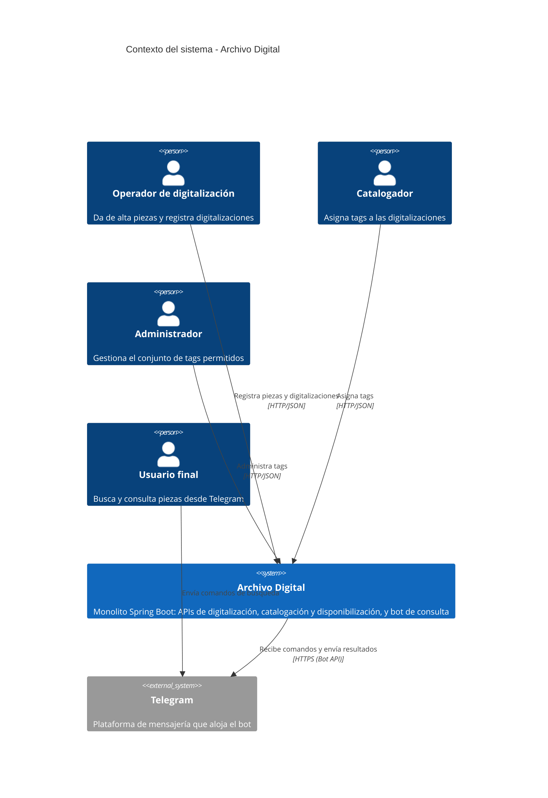
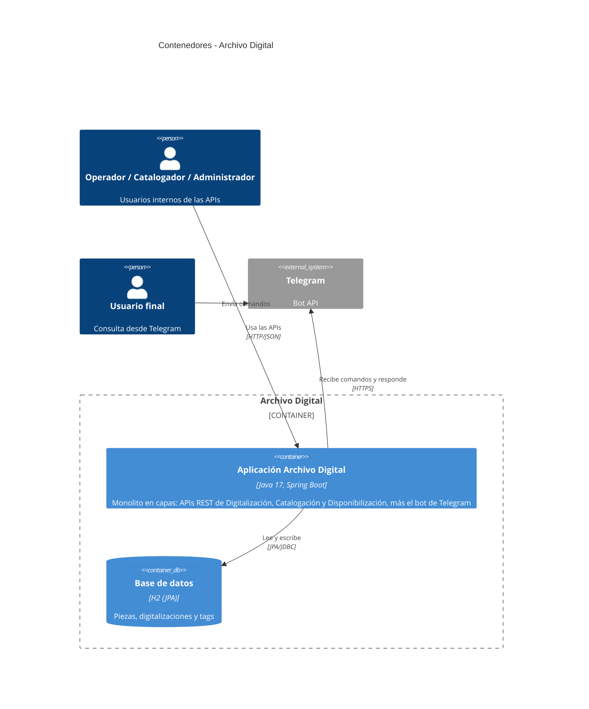
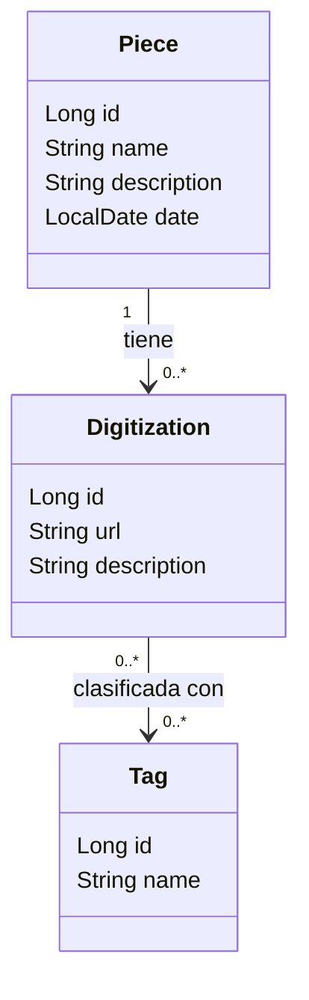

# ARCHITECTURE.md

Documento transversal (no cambia por feature/iteración). Complementa a `AGENTS.md`
(convenciones de código) con la descripción del dominio y la arquitectura general del sistema.

## 1. Descripción general

**Archivo Digital** es una implementación acotada del caso de estudio de la Fundación Memoria
Abierta, cuyo objetivo es digitalizar, catalogar y poner a disposición del público un acervo de
piezas físicas (documentos, fotografías, audio, video).

El sistema cubre el proceso principal en cuatro etapas, resueltas dentro de un **monolito** Java
con Spring Boot y una única base de datos relacional:

1. **Digitalización:** alta de la pieza física y asociación de una o más "digitalizaciones"
   (una URL a un recurso más una descripción).
2. **Catalogación:** asignación de tags a las digitalizaciones. Los tags no son libres: se eligen
   de un conjunto cerrado que un administrador puede modificar en tiempo de ejecución.
3. **Disponibilización:** búsqueda de **piezas** por fecha, nombre, descripción y tags,
   asumiendo un volumen grande de piezas.
4. **Visualización:** un bot de Telegram que permite buscar y mostrar los resultados.

Digitalización, Catalogación y Disponibilización se exponen como **APIs REST** (sin pantallas).
La única interfaz de usuario es el bot de Telegram.

## 2. Actores y sistemas

| Actor / Sistema | Tipo | Interacción con el sistema |
|---|---|---|
| Operador de digitalización | Persona | Da de alta piezas y registra sus digitalizaciones vía API. |
| Catalogador | Persona | Asigna tags a las digitalizaciones vía API. |
| Administrador | Persona | Gestiona el conjunto de tags permitidos (alta, modificación, baja) en tiempo de ejecución. |
| Usuario final | Persona | Busca y consulta piezas desde Telegram. |
| Telegram (Bot API) | Sistema externo | Canal por el que el usuario final interactúa con el bot. |

> Los tres roles internos (operador, catalogador, administrador) se distinguen por
> responsabilidad, no por autenticación: ver "Fuera de alcance".

## 3. Alcance y fuera de alcance

**Dentro de alcance:**
- API de Digitalización: alta de piezas y asociación de digitalizaciones (URL + descripción).
- API de Catalogación: gestión del conjunto de tags (administrador) y asignación de tags a
  digitalizaciones, validando que el tag pertenezca al conjunto vigente.
- API de Disponibilización: búsqueda de piezas por fecha, nombre, descripción y tags, con
  paginación para soportar un volumen grande de piezas.
- Bot de Telegram con comandos de búsqueda y presentación de resultados.
- Monolito Java con Spring Boot, arquitectura en capas (`controller`, `service`, `repository`,
  `model`) y una única base de datos relacional (H2).
- Documentación en `/docs`: diagramas de clases de dominio y de arquitectura, diagrama de base de
  datos, diagramas de secuencia, `api.md` y `test.md`.
- Al menos un test unitario de un `service` por integrante.

**Fuera de alcance:**
- Pantallas o frontend web.
- Autenticación y autorización de los roles internos (se asume que las APIs son de uso confiable
  en el contexto del TP).
- Integración con los sistemas de catalogación legacy (A, B y C) del caso original.
- Transcodificación, streaming, CDN y almacenamiento de archivos: la digitalización es solo una
  URL con su descripción.
- Estadísticas de uso, muestras y recorridos virtuales.
- Extras opcionales de la consigna (despliegue en Render con Postgres, OCR/etiquetado con
  servicios de terceros, carga batch desde CSV).

## 4. Glosario de dominio

| Término | Significado |
|---|---|
| Pieza (`Piece`) | Ítem físico original que se quiere preservar. Es la unidad que se busca. Tiene nombre, descripción y fecha. |
| Digitalización (`Digitization`) | Representación digital de una pieza: una URL a un recurso y una descripción. Una pieza puede tener varias. |
| Tag (`Tag`) | Etiqueta de clasificación perteneciente a un conjunto cerrado administrado en tiempo de ejecución. |
| Catalogación | Proceso de asociar tags a las digitalizaciones. |
| Disponibilización | Proceso de hacer consultable el archivo: búsqueda de piezas por múltiples criterios. |
| Visualización | Presentación de resultados al usuario final a través del bot de Telegram. |
| Administrador | Persona que modifica el conjunto de tags permitidos mientras el sistema está en ejecución. |

> Los nombres entre paréntesis son los nombres de clase propuestos: según `AGENTS.md`, el código
> va en inglés y la documentación en español.

## 5. Vista C4 — Contexto (Nivel 1)

## 6. Vista C4 — Contenedores (Nivel 2)

El sistema es un monolito: un único componente desplegable y una única base de datos.

### Organización interna del monolito

Módulos lógicos del dominio atravesando las capas definidas en `AGENTS.md`:

| Módulo | Entidades principales | Responsabilidad | Expuesto como |
|---|---|---|---|
| Digitalización | `Piece`, `Digitization` | Alta de piezas y registro de digitalizaciones | API REST |
| Catalogación | `Tag` | Gestión de tags y asignación a digitalizaciones | API REST |
| Disponibilización | (consulta sobre `Piece`) | Búsqueda de piezas por fecha, nombre, descripción y tags | API REST |
| Visualización | (sin entidades propias) | Interpretar comandos del bot y presentar resultados | Bot de Telegram |

Flujo entre capas: `controller` → `service` → `repository` → base de datos. El bot de Telegram
actúa como un cliente más de la capa `service` de Disponibilización: no accede a los
repositorios directamente.

## 7. Diagrama de clases de dominio

Versión preliminar, a refinar al diseñar las entidades.

Reglas de dominio identificadas:
- Una digitalización siempre pertenece a una pieza.
- Una digitalización solo puede clasificarse con tags que existan en el conjunto vigente.
- La búsqueda devuelve piezas (no digitalizaciones); una pieza coincide por tag si alguna de
  sus digitalizaciones tiene ese tag.

## 8. Preguntas abiertas / próximos pasos

- Búsqueda por tags: ¿coincidencia con todos los tags indicados (AND) o con alguno (OR)?
- Búsqueda por fecha: ¿fecha exacta o rango?
- Bot de Telegram: ¿long polling o webhook? (long polling es más simple para correr en local).
- Paginación y orden de resultados de la búsqueda.
- Próximo paso: definir issues y labels en `Backlog.md`, completar el README y luego diseñar
  diagramas de base de datos y de secuencia.

## 9. Referencias

- Versión de Java: Java 21.
- Convenciones de código: [`AGENTS.md`](AGENTS.md).
- El equipo adopta la organización de paquetes por capa (controller, service, repository, model, dto) en el código Java según lo especificado en AGENTS.md. La división por módulos de dominio (Digitalización, Catalogación, Disponibilización, Visualización) se mantiene de forma lógica para la trazabilidad de requerimientos funcionales, etiquetas de GitHub y organización del tablero Kanban.
- Consigna: TP Integrador de Diseño de Software.
- Caso de estudio: "Archivo Digital" (Ingeniería del Software I).