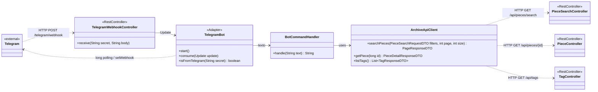

# Bot de Telegram — Visualización

El bot permite buscar piezas del archivo y ver sus digitalizaciones desde Telegram. Es la única interfaz de usuario del sistema: las demás funcionalidades son APIs REST (ver [`api.md`](api.md)).

## Cómo levantarlo

1. **Crear el bot** en Telegram: hablarle a [@BotFather](https://t.me/BotFather), enviar `/newbot`, elegir un nombre y un usuario (tiene que terminar en `bot`). BotFather responde con un **token** (`123456789:AA...`).
2. **Configurar el token**. El token **nunca se commitea**: es la contraseña del bot. Hay dos formas:
   - **Archivo `.env`** (recomendado): copiar [`.env.example`](../.env.example) como `.env` en la raíz del repo y pegar el token. `.env` está en el `.gitignore` y la aplicación lo lee al arrancar (perfil `local`).

     ```properties
     TELEGRAM_BOT_TOKEN=123456789:AA...
     ```

   - **Variable de entorno**, en la misma terminal donde se levanta la aplicación:
     `export TELEGRAM_BOT_TOKEN=123456789:AA...` (Git Bash) o
     `$env:TELEGRAM_BOT_TOKEN = "123456789:AA..."` (PowerShell).
3. **Levantar la aplicación** como siempre (`./mvnw spring-boot:run`). En el log aparece `Telegram bot started (long polling)`.
4. Buscar el bot por su usuario en Telegram (o abrir `https://t.me/<usuario_del_bot>`), tocar **Iniciar** y el bot responde con la bienvenida.

Cada integrante usa **su propio bot y su propio token**: dos aplicaciones corriendo con el mismo token se pisan (ver [Problemas comunes](#problemas-comunes)).

Sin la variable, la aplicación levanta igual y el bot queda apagado (el log avisa `TELEGRAM_BOT_TOKEN is not set`). Así los tests y quien no use el bot no necesitan un token.

## Comandos

| Comando | Qué hace |
|---|---|
| `/buscar <texto>` | Busca piezas cuyo nombre contiene el texto |
| `/buscar nombre: … descripcion: … tag: … desde: … hasta: … pagina: …` | Busca combinando filtros (todos opcionales, se combinan con AND) |
| `/pieza <id>` | Muestra la pieza con sus digitalizaciones (links) y los tags de cada una |
| `/tags` | Muestra los tags que existen, para saber cómo escribirlos en `/buscar` |
| `/start` | Bienvenida y ayuda. Telegram lo envía solo cuando se toca **Iniciar** la primera vez |
| `/ayuda` | Muestra la ayuda |

Filtros de `/buscar`, con las mismas reglas que `GET /api/pieces/search`:

| Filtro | Ejemplo | Detalle |
|---|---|---|
| (texto sin filtro) o `nombre:` | `/buscar carta` | Texto contenido en el nombre, sin distinguir mayúsculas |
| `descripcion:` | `descripcion: manuscrita` | Texto contenido en la descripción |
| `tag:` / `tags:` | `tag: prensa local, cartas` | La pieza tiene que tener **todos** los tags, separados por coma (un tag puede tener varias palabras). El nombre va **completo** (sin distinguir mayúsculas): `testim` no encuentra `Testimonio`; los nombres se ven con `/tags` |
| `desde:` / `hasta:` | `desde: 1970-01-01` | Rango de fechas, inclusive, formato `aaaa-mm-dd` |
| `pagina:` | `pagina: 2` | Los resultados se muestran de a 10; empieza en 1 |

Los filtros se pueden escribir con o sin tilde y en mayúsculas o minúsculas (`descripción:`, `Pagina:`). Un filtro que no existe (por ejemplo `fecha:`) no se busca: el bot responde cuáles son los filtros válidos.

Los resultados se ordenan por fecha (más nuevas primero), igual que en la API.

Si se edita un mensaje ya enviado (por ejemplo, para corregir un filtro), el bot responde de nuevo con el texto editado.

## Ejemplo

Con los datos semilla del perfil `local` (`data.sql`):

```text
/buscar carta tag: cartas desde: 1970-01-01

Encontré 1 pieza(s):

#1 · Carta desde Cordoba · 1977-05-03
Carta manuscrita enviada a la familia

Para ver una pieza: /pieza <id>
```

```text
/pieza 1

#1 · Carta desde Cordoba
Fecha: 1977-05-03
Carta manuscrita enviada a la familia

Digitalizaciones (2):

1. Escaneo de la pagina 1
   https://archivo.example/carta-cordoba-p1.pdf
   Tags: Cartas, Manuscrito

2. Escaneo de la pagina 2
   https://archivo.example/carta-cordoba-p2.pdf
   Tags: Cartas, Manuscrito
```

## Cómo probarlo

Con la aplicación levantada en perfil `local` (los datos semilla se cargan solos al arrancar):

| Mensaje | Respuesta esperada |
|---|---|
| Tocar **Iniciar** (`/start`) | Bienvenida con ejemplos y la ayuda |
| `/tags` | `Tags (6): Afiches, Cartas, Fotografia, Manuscrito, Prensa, Testimonio` |
| `/buscar` | Las 6 piezas, de la más nueva a la más vieja |
| `/buscar carta` | #1 Carta desde Cordoba |
| `/buscar tag: testimonio` | #4 Testimonio grabado en casete |
| `/buscar tag: testim` | Sin resultados y sugiere `/tags` (el tag va completo) |
| `/buscar desde: 1982-01-01` | #4, #3 y #5 |
| `/buscar descripción: marcha` | #5 y #2 (el filtro acepta tilde) |
| `/pieza 1` | La carta con sus 2 digitalizaciones, links y tags |
| `/pieza 6` | "Todavía no tiene digitalizaciones." |
| `/pieza 99` | "No existe la pieza 99." |
| `/buscar desde: 03/05/1977` | Explica cómo escribir la fecha |
| `/buscar desde: 1990-01-01 hasta: 1980-01-01` | "Revisá los filtros de la búsqueda: …" (error 400 de la API) |
| `/buscar fecha: 1977` | Avisa que el filtro no existe y lista los válidos |
| `/hola` | "No conozco ese comando." y la ayuda |
| Editar un mensaje ya enviado | Responde de nuevo con el texto editado |

Respuestas ante errores: sin resultados ("No encontré piezas con esos filtros."; si se filtró por tag, sugiere `/tags`), fecha mal escrita, filtros rechazados por la API (por ejemplo, rango de fechas invertido), pieza inexistente ("No existe la pieza 99."), API sin responder y comando desconocido (muestra la ayuda).

## Problemas comunes

| Síntoma | Causa y solución |
|---|---|
| Log: `TELEGRAM_BOT_TOKEN is not set` | No encontró el token: revisar que `.env` esté en la raíz del repo (al lado de `pom.xml`) con `TELEGRAM_BOT_TOKEN=...`, o que la variable de entorno esté en la misma terminal |
| Log: error `401 Unauthorized` al arrancar | El token está mal copiado o fue revocado en BotFather. La API sigue funcionando igual |
| Log: `409 Conflict: can't use getUpdates method while webhook is active` | El token tiene un webhook registrado por una instancia desplegada. Al levantar en `polling` se borra solo; si el error sigue, usar un bot distinto para desarrollo |
| Log: `409 Conflict: terminated by other getUpdates request` | Hay dos aplicaciones con el mismo token (por ejemplo, la app levantada dos veces o dos integrantes con el mismo bot). Dejar una sola corriendo |
| El bot no responde | La aplicación no está levantada o arrancó sin token (ver la primera fila) |
| No aparece la descripción al abrir el bot | Telegram la muestra solo en un chat nuevo, antes de tocar **Iniciar**, y puede tardar unos minutos en actualizarse |

## Despliegue: long polling o webhook

El bot funciona igual en local y en un servidor (Render, Railway, una VM, etc.). Solo cambia cómo recibe los mensajes:

| Modo | Cómo funciona | Cuándo usarlo |
|---|---|---|
| `polling` (por defecto) | La aplicación le pregunta a Telegram si hay mensajes nuevos | En local, o en un servidor que **no se apaga** |
| `webhook` | Telegram envía cada mensaje a `https://<url-de-la-app>/telegram/webhook` | En un servidor con URL pública HTTPS. Es necesario en planes que **apagan la aplicación sin tráfico** (por ejemplo, Render gratis), porque la llamada de Telegram la despierta; el primer mensaje después de dormir tarda más |

En el perfil `local` siempre es `polling`. En el perfil `prod` se configura con variables de entorno, en el panel del servidor (no con `.env`):

| Variable | Ejemplo | Detalle |
|---|---|---|
| `SPRING_PROFILES_ACTIVE` | `prod` | Perfil de producción |
| `TELEGRAM_BOT_TOKEN` | `123456789:AA...` | Conviene un bot **distinto** al de desarrollo, para que no se pise con quien lo corre en local |
| `TELEGRAM_BOT_MODE` | `webhook` | `polling` si no se define |
| `TELEGRAM_WEBHOOK_URL` | `https://archivo-digital.onrender.com` | URL pública de la aplicación, sin la ruta. Obligatoria en modo webhook |
| `TELEGRAM_WEBHOOK_SECRET` | (opcional) | Secreto que Telegram manda en cada llamada (`X-Telegram-Bot-Api-Secret-Token`) para que nadie más pueda enviarle mensajes falsos al bot. Si no se define, se genera uno al azar en cada arranque |
| `PORT` | (lo define el servidor) | Puerto donde escucha la aplicación; `8080` si no está |

Al arrancar en modo webhook, la aplicación registra la URL en Telegram (`setWebhook`) y en el log aparece `Telegram bot started (webhook at …)`. Si después se vuelve a levantar en modo `polling` con el mismo token, el webhook se borra solo.

La base de datos de `prod` (por ejemplo, PostgreSQL en Render) no depende del bot: el bot solo usa la API REST.

## Diseño

- **Dos modos de recibir mensajes** (`telegram.bot.mode`): **long polling** en local (la aplicación le pregunta a Telegram si hay mensajes nuevos, sin exponerse a internet) y **webhook** en un servidor desplegado (Telegram llama a la aplicación). Ver [Despliegue](#despliegue-long-polling-o-webhook). Se usa la librería `telegrambots` (`telegrambots-longpolling` y `telegrambots-client`).
- **El bot es un cliente más de la API REST:** llama por HTTP a los controllers (`GET /api/pieces/search`, `GET /api/pieces/{id}` y `GET /api/tags`), no a los services. Así respeta las capas de Fowler (presentación → service → repositorio) y recibe las mismas validaciones y respuestas de error (`{status, message}`) que cualquier otro cliente.
- **Adapter para la plataforma de chat:** solo `TelegramBot` conoce Telegram. Traduce un mensaje de Telegram a texto, se lo pasa a `BotCommandHandler` y traduce la respuesta a un mensaje de Telegram. Para usar WhatsApp alcanzaría con escribir otro adapter: los comandos y el cliente de la API quedan igual.

| Clase | Responsabilidad |
|---|---|
| `TelegramBot` | **Adapter** de Telegram: arranca con la aplicación si hay token, recibe los mensajes nuevos y editados (por long polling, o por webhook a través de `TelegramWebhookController`), envía las respuestas y registra el menú de comandos y la descripción que Telegram muestra antes de tocar **Iniciar** |
| `BotCommandHandler` | Comandos, sin depender de Telegram: interpreta el texto, llama a la API y arma la respuesta |
| `TelegramWebhookController` | Solo en modo webhook: recibe en `POST /telegram/webhook` los mensajes que envía Telegram, verifica el secreto (si no coincide responde `401`) y se los pasa a `TelegramBot` |
| `ArchiveApiClient` | Cliente HTTP de nuestra API REST (`RestClient`). Convierte las respuestas de error en `ArchiveApiException` con el status y el mensaje |



- La URL de la API se configura con `archive.api.base-url` (por defecto la propia aplicación, `http://localhost:8080`). Si la API no responde, el bot contesta que no pudo consultar el archivo.
- **Sin N+1:** la búsqueda es paginada en la base y el detalle trae las digitalizaciones con sus tags en una sola consulta (ver `GET /api/pieces/{id}` en `api.md`).

Diagrama de secuencia: [`diagrams/sequence-bot-search.md`](diagrams/sequence-bot-search.md).
