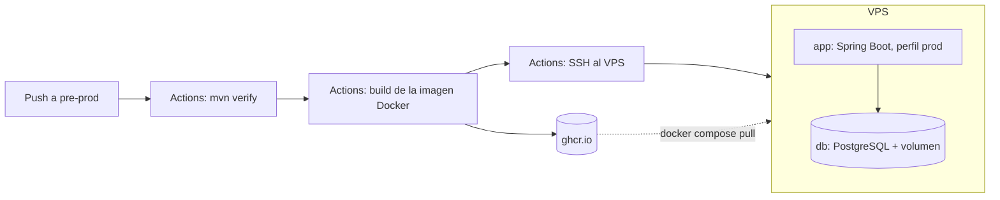

# Deploy en un VPS (GitHub Actions + Docker)

Extra opcional de la consigna. En local no cambia nada: se sigue usando `./mvnw spring-boot:run` con H2.

## Cómo funciona



1. **`test`**: corre `mvn verify` (tests, checkstyle, PMD, SpotBugs). Si falla, no se despliega nada.
2. **`image`**: arma la imagen con el `Dockerfile` y la publica en GitHub Container Registry (`ghcr.io`).
3. **`deploy`**: entra por SSH al VPS, copia `docker-compose.yml`, baja la imagen nueva y reinicia la app.

| Archivo | Qué hace |
|---|---|
| `Dockerfile` | Etapa 1: compila el `.jar` con Maven. Etapa 2: imagen chica solo con Java 21 (JRE) y el `.jar` |
| `docker-compose.yml` | Levanta `app` y `db` (PostgreSQL). Los datos quedan en el volumen `db-data`, que sobrevive a los deploys |
| `.github/workflows/deploy.yml` | Los tres pasos de arriba |
| `application-prod.properties` | Lee la base de `DB_URL`, `DB_USERNAME`, `DB_PASSWORD`. Sin ellas usa H2 en memoria |

El bot usa **long polling** también en el servidor: el VPS está siempre prendido y es la app la que le pide los
mensajes a Telegram, así que no hace falta dominio ni HTTPS.

## Preparar el VPS (una sola vez)

Se usa un usuario `deploy` sin `sudo`, solo para el deploy: GitHub Actions entra con él por SSH.

```bash
# Con un usuario administrador: instalar Docker y dejar que deploy lo use
curl -fsSL https://get.docker.com | sudo sh
sudo usermod -aG docker deploy

# Como deploy: carpeta de la app y variables (no se commitean)
sudo -iu deploy
mkdir -p ~/archivo-digital && cd ~/archivo-digital
echo "DB_PASSWORD=$(openssl rand -hex 24)" > .env
echo "TELEGRAM_BOT_TOKEN=" >> .env      # completar con el token de BotFather
chmod 600 .env
docker run --rm hello-world             # comprobar que deploy puede usar Docker
```

## Secrets en GitHub

En el repo: *Settings → Secrets and variables → Actions*.

| Secret | Valor |
|---|---|
| `VPS_HOST` | IP o dominio del VPS |
| `VPS_USER` | Usuario con permiso para usar Docker |
| `VPS_SSH_KEY` | Clave privada SSH cuya pública está en `~/.ssh/authorized_keys` del VPS |

Después de cada push a la rama `pre-prod`, la API queda en `http://<ip-del-vps>:8080`.
(El botón *Actions → Deploy → Run workflow* aparece recién cuando `deploy.yml` está en `main`.)

## Probarlo en local con Docker

```bash
DB_PASSWORD=prueba docker compose up --build    # API en http://localhost:8080 con PostgreSQL
docker compose down -v                          # apagar y borrar la base de prueba
```

> En `prod` no se carga `data.sql`: la base arranca vacía y los datos se crean por la API.
