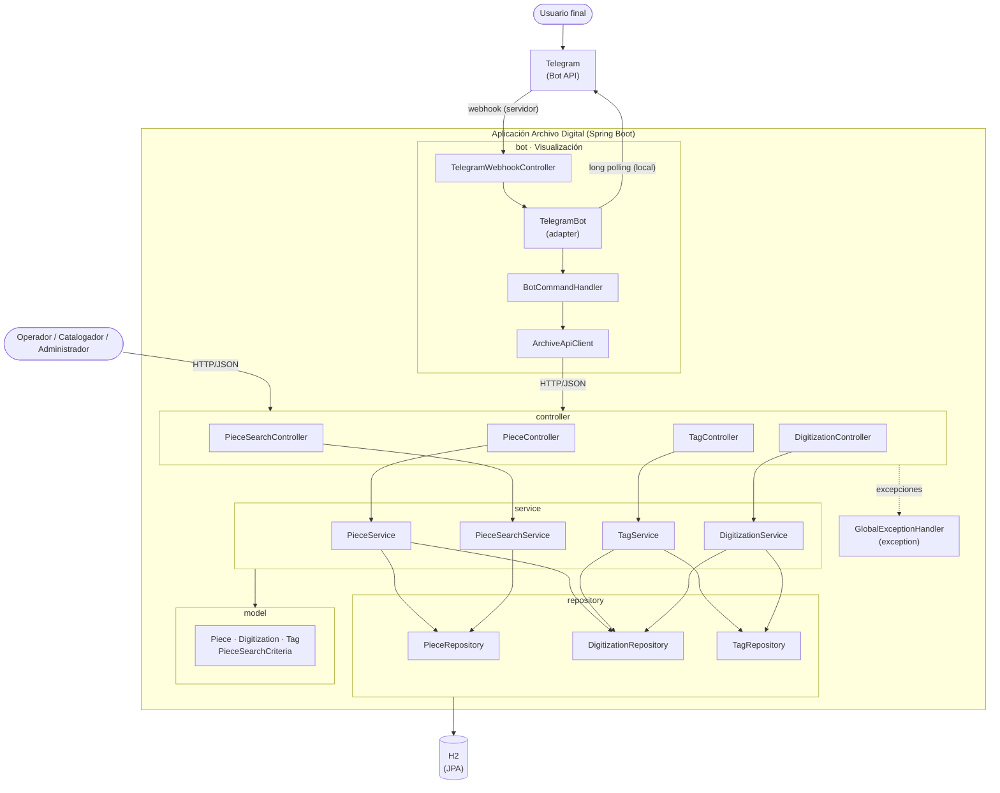
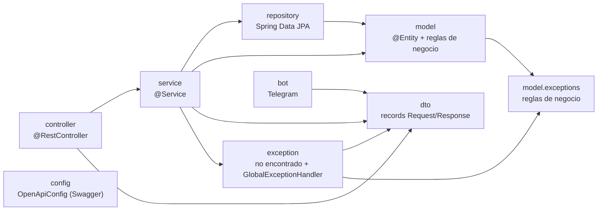

# Architecture Diagram — Components and Packages

Vista interna del monolito: los componentes de cada capa y cómo se comunican. Es el nivel que
sigue a las vistas C4 de contexto y de contenedores de `ARCHITECTURE.md` (secciones 5 y 6).

## Componentes por capa

Cada columna es un módulo del dominio y cada franja es una capa. Las flechas indican quién usa a
quién: una capa solo llama a la de abajo.

| Módulo | Controller | Service | Repository |
|---|---|---|---|
| Digitalización | `PieceController` | `PieceService` | `PieceRepository`, `DigitizationRepository` |
| Catalogación | `TagController`, `DigitizationController` | `TagService`, `DigitizationService` | `TagRepository`, `DigitizationRepository` |
| Disponibilización | `PieceSearchController` | `PieceSearchService` | `PieceRepository` |
| Visualización | (bot: `TelegramBot`, `TelegramWebhookController`) | `BotCommandHandler` | — (usa la API por HTTP) |

## Paquetes

Organización por capa definida en `AGENTS.md`, todo bajo `ar.edu.unsam.ddso.tp`:

## Notas

- **Monolito en capas:** `controller` → `service` → `repository` → base de datos. Los
  controllers no tienen lógica de negocio ni acceden a los repositories. Las reglas propias de
  cada entidad viven en `model` (por ejemplo `Digitization.addTag` o la validación de fechas de
  `PieceSearchCriteria`).
- **Las entidades no salen de la aplicación:** los services devuelven DTOs (`dto`) y los
  controllers solo exponen DTOs.
- **Errores en un solo lugar:** las excepciones que lanzan los services y el modelo llegan a
  `GlobalExceptionHandler`, que las traduce a una respuesta HTTP con el status que corresponde.
- **El bot es un cliente más de la API:** `ArchiveApiClient` llama por HTTP a los controllers, así
  que el bot pasa por las mismas validaciones y errores que cualquier cliente. `TelegramBot` es el
  único componente que conoce Telegram (ver [`bot.md`](../bot.md#diseño)).
- **Swagger UI:** `config.OpenApiConfig` agrupa los endpoints por módulo en
  `/swagger-ui.html` (ver [`api.md`](../api.md)).
