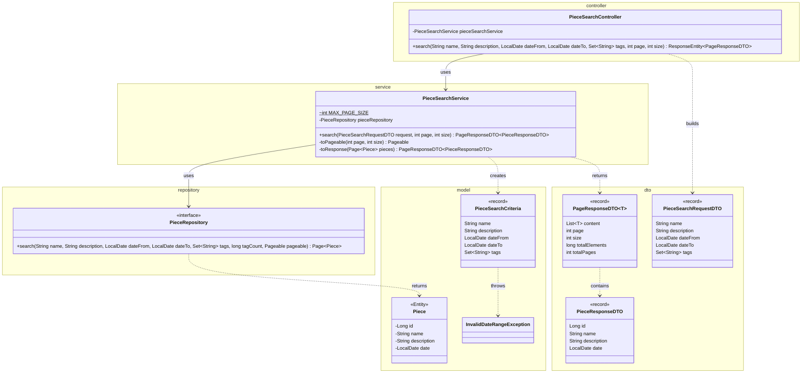

# Class Diagram

Diseño detallado por capas de cada módulo del dominio (ver `ARCHITECTURE.md`, sección 6). Cada
diagrama agrupa las clases por paquete (`controller`, `service`, `repository`, `model`, `dto`,
`exception`) y muestra solo las que usa ese módulo:

| Módulo | Sección |
|---|---|
| Digitalización | [Digitalización](#digitalización) |
| Catalogación | [Catalogación](#catalogación) |
| Disponibilización | [Disponibilización](#disponibilización) |
| Visualización (bot de Telegram) | [`bot.md`](../bot.md#diseño) |

La vista simplificada de las entidades está en `ARCHITECTURE.md` (sección 7) y las tablas en
[`database-diagram.md`](database-diagram.md).

## Digitalización

Alta de piezas, registro de digitalizaciones y detalle de una pieza. Se incluye `Tag` porque
`Digitization` lo referencia.

```mermaid
classDiagram
    direction TB

    namespace controller {
        class PieceController {
            -PieceService pieceService
            +getPiece(Long id) ResponseEntity~PieceDetailResponseDTO~
            +createPiece(PieceCreateRequestDTO request) ResponseEntity~PieceResponseDTO~
            +addDigitization(Long id, DigitizationCreateRequestDTO request) ResponseEntity~DigitizationResponseDTO~
        }
    }

    namespace service {
        class PieceService {
            -PieceRepository pieceRepository
            -DigitizationRepository digitizationRepository
            +getPiece(Long id) PieceDetailResponseDTO
            +createPiece(PieceCreateRequestDTO request) PieceResponseDTO
            +addDigitization(Long pieceId, DigitizationCreateRequestDTO request) DigitizationResponseDTO
            -toResponse(Piece piece) PieceResponseDTO
        }
        class DigitizationMapper {
            <<utility>>
            +toResponse(Digitization digitization)$ DigitizationResponseDTO
        }
    }

    namespace repository {
        class PieceRepository {
            <<interface>>
        }
        class DigitizationRepository {
            <<interface>>
            +findByPieceIdOrderByIdAsc(Long pieceId) List~Digitization~
        }
        class JpaRepository {
            <<interface>>
            +save(entity)
            +findById(id) Optional
        }
    }

    namespace model {
        class Piece {
            <<Entity>>
            -Long id
            -String name
            -String description
            -LocalDate date
        }
        class Digitization {
            <<Entity>>
            -Long id
            -String url
            -String description
            -Piece piece
            -Set~Tag~ tags
            +addTag(Tag tag) void
            +removeTag(Long tagId) void
        }
        class Tag {
            <<Entity>>
            -Long id
            -String name
        }
    }

    namespace dto {
        class PieceCreateRequestDTO {
            <<record>>
            @NotBlank @Size(max=255) String name
            @Size(max=1000) String description
            LocalDate date
        }
        class PieceResponseDTO {
            <<record>>
            Long id
            String name
            String description
            LocalDate date
        }
        class PieceDetailResponseDTO {
            <<record>>
            Long id
            String name
            String description
            LocalDate date
            List~DigitizationResponseDTO~ digitizations
        }
        class DigitizationCreateRequestDTO {
            <<record>>
            @NotBlank @URL @Size(max=255) String url
            @Size(max=1000) String description
        }
        class DigitizationResponseDTO {
            <<record>>
            Long id
            String url
            String description
            Long pieceId
            List~TagResponseDTO~ tags
        }
        class ErrorResponseDTO {
            <<record>>
            int status
            String message
        }
    }

    namespace exception {
        class PieceNotFoundException {
            +PieceNotFoundException(Long id)
        }
        class GlobalExceptionHandler {
            <<RestControllerAdvice>>
            +handleNotFound(RuntimeException ex) ResponseEntity~ErrorResponseDTO~
            +handleInvalidRequest(MethodArgumentNotValidException ex) ResponseEntity~ErrorResponseDTO~
        }
    }

    %% Layer dependencies
    PieceController --> PieceService : uses
    PieceService --> PieceRepository : uses
    PieceService --> DigitizationRepository : uses
    PieceService --> DigitizationMapper : maps with
    PieceRepository --|> JpaRepository : extends
    DigitizationRepository --|> JpaRepository : extends

    %% Domain relationships
    Piece "1" <-- "0..*" Digitization : belongs to
    Digitization "0..*" --> "0..*" Tag : classified with

    %% DTOs and exceptions
    PieceController ..> PieceCreateRequestDTO : receives
    PieceController ..> DigitizationCreateRequestDTO : receives
    PieceService ..> PieceResponseDTO : returns
    PieceService ..> PieceDetailResponseDTO : returns
    PieceService ..> DigitizationResponseDTO : returns
    PieceService ..> PieceNotFoundException : throws
    GlobalExceptionHandler ..> PieceNotFoundException : handles
    GlobalExceptionHandler ..> ErrorResponseDTO : returns
```

### Notas

- **Controller → Service → Repository:** cada capa solo se comunica con la de abajo. El
  controller nunca accede directamente a los repositories.
- **Las entidades no se exponen:** el service convierte `Piece` y `Digitization` en DTOs de
  respuesta (`toResponse`), así la API nunca devuelve entidades JPA. El mapeo de `Digitization`
  vive en un solo lugar, `DigitizationMapper` (capa service), que usan `PieceService` y
  `DigitizationService`.
- **Piece ↔ Digitization:** una digitalización siempre pertenece a una pieza (`@ManyToOne`,
  `piece_id` es obligatorio). Una pieza puede tener cero o muchas digitalizaciones.
- **Digitization ↔ Tag:** relación muchos a muchos (`@ManyToMany`), guardada en la tabla
  intermedia `digitization_tags`. Una digitalización nueva se crea sin tags; los tags se asignan con `addTag`, que no agrega un tag repetido, y se quitan con `removeTag` (ver `sequence-assign-tag.md`). La respuesta (`DigitizationResponseDTO`) incluye los tags de la digitalización.
- **Detalle de una pieza:** `getPiece` trae la pieza y después sus digitalizaciones con
  `findByPieceIdOrderByIdAsc`, que usa `@EntityGraph` para cargar los tags en la misma consulta
  (dos consultas en total, sin importar cuántas digitalizaciones tenga la pieza).
- **Errores:** el service lanza `PieceNotFoundException` y `GlobalExceptionHandler` la
  traduce a un HTTP 404 con un `ErrorResponseDTO` en el cuerpo.
- **Validación de entrada:** el controller recibe los bodies con `@Valid`. Si un campo no cumple  las anotaciones del DTO, Spring lanza `MethodArgumentNotValidException` antes de llegar al service, y `GlobalExceptionHandler` responde 400 indicando el campo (por ejemplo `"name: must not be blank"`).

## Catalogación

Gestión del conjunto de tags (administrador) y asignación de tags a digitalizaciones
(catalogador).

```mermaid
classDiagram
    direction TB

    namespace controller {
        class TagController {
            -TagService tagService
            +findAll() ResponseEntity~List~TagResponseDTO~~
            +findById(Long id) ResponseEntity~TagResponseDTO~
            +create(TagRequestDTO request) ResponseEntity~TagResponseDTO~
            +rename(Long id, TagRequestDTO request) ResponseEntity~TagResponseDTO~
            +delete(Long id) ResponseEntity~Void~
        }
        class DigitizationController {
            -DigitizationService digitizationService
            +addTag(Long id, Long tagId) ResponseEntity~DigitizationResponseDTO~
            +removeTag(Long id, Long tagId) ResponseEntity~DigitizationResponseDTO~
        }
    }

    namespace service {
        class TagService {
            -TagRepository tagRepository
            -DigitizationRepository digitizationRepository
            +findAll() List~TagResponseDTO~
            +findById(Long id) TagResponseDTO
            +create(TagRequestDTO request) TagResponseDTO
            +rename(Long id, TagRequestDTO request) TagResponseDTO
            +delete(Long id) void
            -getTag(Long id) Tag
            -validName(String name) String
            -toResponse(Tag tag) TagResponseDTO
        }
        class DigitizationService {
            -DigitizationRepository digitizationRepository
            -TagRepository tagRepository
            +addTag(Long digitizationId, Long tagId) DigitizationResponseDTO
            +removeTag(Long digitizationId, Long tagId) DigitizationResponseDTO
        }
        class DigitizationMapper {
            <<utility>>
            +toResponse(Digitization digitization)$ DigitizationResponseDTO
        }
    }

    namespace repository {
        class TagRepository {
            <<interface>>
            +existsByNameIgnoreCase(String name) boolean
            +existsByNameIgnoreCaseAndIdNot(String name, Long id) boolean
        }
        class DigitizationRepository {
            <<interface>>
            +existsByTagsId(Long tagId) boolean
        }
        class JpaRepository {
            <<interface>>
            +save(entity)
            +findById(id) Optional
            +findAll() List
            +delete(entity)
        }
    }

    namespace model {
        class Digitization {
            <<Entity>>
            -Long id
            -String url
            -String description
            -Piece piece
            -Set~Tag~ tags
            +addTag(Tag tag) void
            +removeTag(Long tagId) void
        }
        class Tag {
            <<Entity>>
            -Long id
            -String name
        }
        class DuplicateTagException
        class TagInUseException
        class InvalidTagNameException
    }

    namespace dto {
        class TagRequestDTO {
            <<record>>
            @Size(max=255) String name
        }
        class TagResponseDTO {
            <<record>>
            Long id
            String name
        }
        class DigitizationResponseDTO {
            <<record>>
            Long id
            String url
            String description
            Long pieceId
            List~TagResponseDTO~ tags
        }
    }

    namespace exception {
        class TagNotFoundException
        class DigitizationNotFoundException
        class GlobalExceptionHandler {
            <<RestControllerAdvice>>
            +handleNotFound(RuntimeException ex) ResponseEntity~ErrorResponseDTO~
            +handleConflict(RuntimeException ex) ResponseEntity~ErrorResponseDTO~
            +handleBadRequest(RuntimeException ex) ResponseEntity~ErrorResponseDTO~
        }
    }

    %% Layer dependencies
    TagController --> TagService : uses
    DigitizationController --> DigitizationService : uses
    TagService --> TagRepository : uses
    TagService --> DigitizationRepository : uses
    DigitizationService --> DigitizationRepository : uses
    DigitizationService --> TagRepository : uses
    DigitizationService --> DigitizationMapper : maps with
    TagRepository --|> JpaRepository : extends
    DigitizationRepository --|> JpaRepository : extends

    %% Domain relationships
    Digitization "0..*" --> "0..*" Tag : classified with

    %% DTOs and exceptions
    TagController ..> TagRequestDTO : receives
    TagService ..> TagResponseDTO : returns
    DigitizationService ..> DigitizationResponseDTO : returns
    TagService ..> DuplicateTagException : throws
    TagService ..> TagInUseException : throws
    TagService ..> InvalidTagNameException : throws
    TagService ..> TagNotFoundException : throws
    DigitizationService ..> TagNotFoundException : throws
    DigitizationService ..> DigitizationNotFoundException : throws
    GlobalExceptionHandler ..> TagNotFoundException : 404
    GlobalExceptionHandler ..> DigitizationNotFoundException : 404
    GlobalExceptionHandler ..> DuplicateTagException : 409
    GlobalExceptionHandler ..> TagInUseException : 409
    GlobalExceptionHandler ..> InvalidTagNameException : 400
```

### Notas

- **Conjunto cerrado de tags:** solo se puede asignar un tag que exista. `DigitizationService.addTag`
  busca el tag por id y, si no está, lanza `TagNotFoundException` (404). Los tags no se crean al
  asignarlos.
- **La asignación vive en la entidad:** `DigitizationService` busca la digitalización y el tag, y
  delega en `Digitization.addTag` / `removeTag`, que evitan repetidos y quitan por id (ver
  `sequence-assign-tag.md`).
- **Nombre del tag:** `TagService` lo guarda sin espacios al principio ni al final, rechaza el
  nombre vacío (`InvalidTagNameException`, 400) y el repetido sin distinguir mayúsculas
  (`DuplicateTagException`, 409).
- **Baja de un tag:** `TagService.delete` pregunta a `DigitizationRepository.existsByTagsId` si el
  tag está asignado; si lo está, lanza `TagInUseException` (409) en vez de borrarlo.
- **Excepciones:** las de reglas de negocio están en `model/exceptions` (`DuplicateTagException`,
  `TagInUseException`, `InvalidTagNameException`) y las de "no encontrado" en `exception`. En el
  diagrama, las de `model/exceptions` aparecen dentro de `model`.

## Disponibilización

Búsqueda paginada de piezas por nombre, descripción, rango de fechas y tags.

### Notas

- **Devuelve piezas, no digitalizaciones:** la respuesta es una página de `PieceResponseDTO`.
- **Reglas de la búsqueda en el modelo:** `PieceSearchCriteria` valida el rango de fechas (si
  `dateFrom` es posterior a `dateTo` lanza `InvalidDateRangeException`, 400) y normaliza los
  textos (sin espacios de más y en minúsculas), para que la búsqueda no distinga mayúsculas.
- **Una sola consulta paginada:** `PieceRepository.search` filtra en la base con una consulta JPQL
  (`@Query`). Un filtro vacío no restringe. Para los tags (AND) cuenta cuántos de los tags
  pedidos tiene la pieza en sus digitalizaciones y exige que sean todos (`tagCount`).
- **Paginación y orden:** `PieceSearchService` arma el `Pageable` con 20 resultados por defecto
  (el default del controller), máximo 50 (`MAX_PAGE_SIZE`), y ordena por fecha descendente y, ante
  empate, por id.
