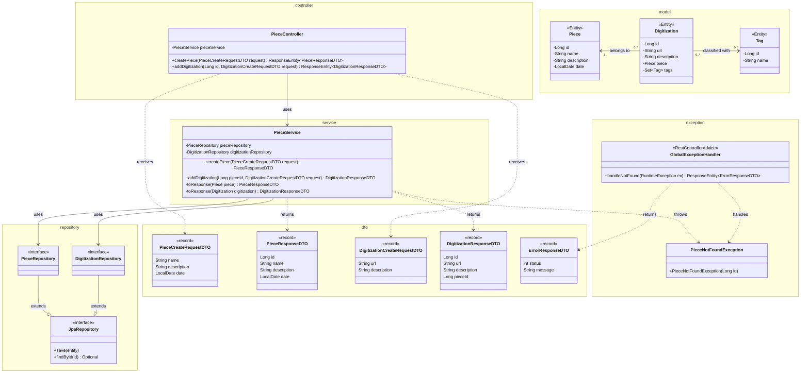

# Class Diagram — Digitization Module

Clases del módulo de Digitalización agrupadas por capa (Controller, Service, Repository, Model),
sumadas a los DTOs y las excepciones que usan. Se incluye `Tag` porque `Digitization` lo referencia.

## Notas

- **Controller → Service → Repository:** cada capa solo se comunica con la de abajo. El
  controller nunca accede directamente a los repositories.
- **Las entidades no se exponen:** el service convierte `Piece` y `Digitization` en DTOs de
  respuesta (`toResponse`), así la API nunca devuelve entidades JPA.
- **Piece ↔ Digitization:** una digitalización siempre pertenece a una pieza (`@ManyToOne`,
  `piece_id` es obligatorio). Una pieza puede tener cero o muchas digitalizaciones.
- **Digitization ↔ Tag:** relación muchos a muchos (`@ManyToMany`), guardada en la tabla
  intermedia `digitization_tags`. Una digitalización nueva se crea sin tags.
- **Errores:** el service lanza `PieceNotFoundException` y `GlobalExceptionHandler` la
  traduce a un HTTP 404 con un `ErrorResponseDTO` en el cuerpo.
