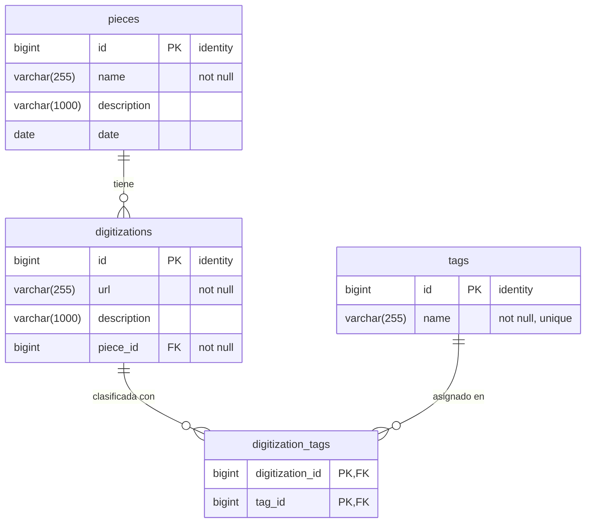

# Database Diagram

Tablas de la base de datos relacional (H2) que genera JPA a partir de las entidades del paquete
`model`. Es una sola base para todo el monolito.

## Tablas

| Tabla | Entidad | Contenido |
|---|---|---|
| `pieces` | `Piece` | Piezas físicas del archivo |
| `digitizations` | `Digitization` | Digitalizaciones (URL + descripción) de cada pieza |
| `tags` | `Tag` | Conjunto cerrado de tags vigentes |
| `digitization_tags` | (tabla intermedia) | Qué tags tiene cada digitalización |

## Notas

- **Claves primarias:** `pieces`, `digitizations` y `tags` usan un `id` autoincremental
  (`GenerationType.IDENTITY`). `digitization_tags` usa la clave compuesta
  (`digitization_id`, `tag_id`), así que una digitalización no puede tener dos veces el mismo tag.
- **Pieza → digitalizaciones (1 a N):** `digitizations.piece_id` es obligatorio, porque una
  digitalización siempre pertenece a una pieza (`@ManyToOne(optional = false)`).
- **Digitalización ↔ tag (N a N):** `@ManyToMany` en `Digitization.tags`, guardado en
  `digitization_tags`. La relación es entre tags y **digitalizaciones**, no piezas. Una pieza
  tiene un tag si alguna de sus digitalizaciones lo tiene, y así lo usa la búsqueda.
- **Nombre de tag único:** `tags.name` tiene una restricción `unique`. Además, `TagService`
  rechaza nombres repetidos sin distinguir mayúsculas (`Prensa` y `prensa`).
- **Eliminar un tag:** no se puede borrar un tag que todavía está en `digitization_tags`: la API
  responde `409` (ver `DELETE /api/tags/{id}` en [`api.md`](../api.md)).
- **Esquema:** lo crea Hibernate al arrancar (`ddl-auto=create-drop` en `local`, `update` en
  `prod`). En `local` se cargan los datos de prueba de `src/main/resources/data.sql`.
