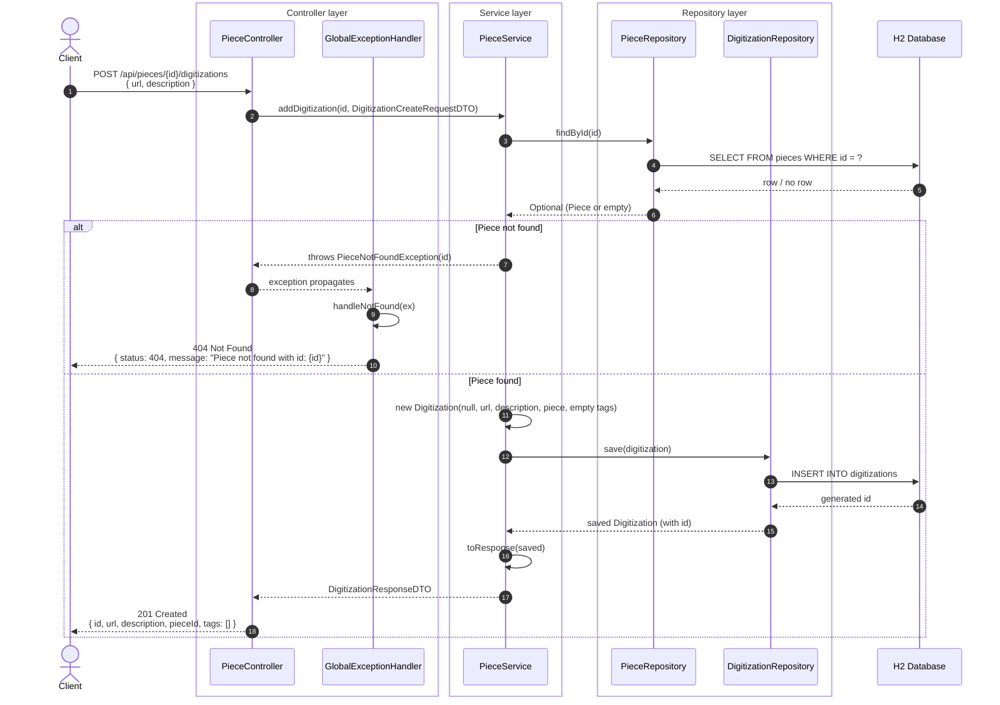

# Sequence Diagram — Add Digitization to a Piece

Flujo de `POST /api/pieces/{id}/digitizations`: registra una digitalización (archivo digital)
para una pieza existente. Incluye el camino de error cuando la pieza no existe.



## Notas

- Toda la operación corre dentro de una transacción (`@Transactional` en `addDigitization`).
- El service verifica que la pieza exista antes de crear la digitalización, así nunca queda
  una digitalización sin pieza.
- La digitalización nueva arranca sin tags. La asignación de tags es un flujo aparte.
- El controller no atrapa `PieceNotFoundException`: Spring se la pasa a
  `GlobalExceptionHandler`, que arma la respuesta 404.

## Ejemplo

Pedido:

```http
POST /api/pieces/1/digitizations
Content-Type: application/json

{ "url": "https://files.example/letter-p1.pdf", "description": "Scan of page 1" }
```

Respuesta `201 Created`:

```json
{ "id": 10, "url": "https://files.example/letter-p1.pdf", "description": "Scan of page 1", "pieceId": 1, "tags": [] }
```

Respuesta cuando la pieza `99` no existe, `404 Not Found`:

```json
{ "status": 404, "message": "Piece not found with id: 99" }
```
