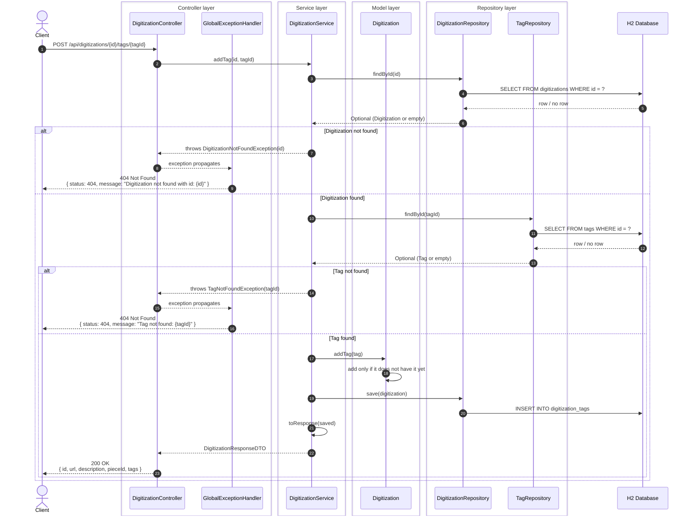

# Sequence Diagram — Assign Tag to a Digitization

Flujo de `POST /api/digitizations/{id}/tags/{tagId}`: cataloga una digitalización con un tag
del conjunto vigente. Incluye los caminos de error cuando la digitalización o el tag no existen.



## Notas

- Toda la operación corre dentro de una transacción (`@Transactional` en `addTag`).
- La regla "un tag no se repite" vive en la entidad (`Digitization.addTag`), no en el service:
  el service busca, delega la regla y guarda.
- Si alguno de los dos no existe, no se guarda nada. El controller no atrapa las excepciones:
  `GlobalExceptionHandler` arma la respuesta 404.
- Si el tag ya estaba asignado, no se inserta otra fila en `digitization_tags` y la respuesta es
  la misma.

## Ejemplo

Pedido:

```http
POST /api/digitizations/10/tags/1
```

Respuesta `200 OK`:

```json
{
  "id": 10,
  "url": "https://files.example/letter-p1.pdf",
  "description": "Scan of page 1",
  "pieceId": 1,
  "tags": [ { "id": 1, "name": "Press" } ]
}
```

Respuesta cuando el tag `99` no existe, `404 Not Found`:

```json
{ "status": 404, "message": "Tag not found: 99" }
```
