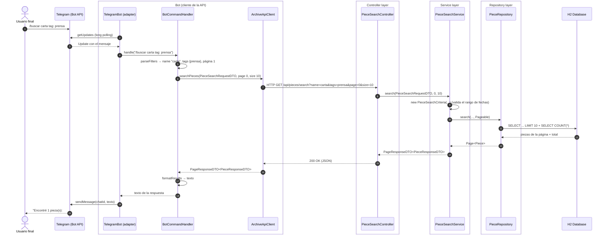

# Sequence Diagram — Search from the Telegram Bot

Flujo de `/buscar` desde Telegram: el usuario busca piezas y el bot responde con la lista. El bot es un cliente más de la API REST: llama por HTTP al mismo endpoint que cualquier cliente (`GET /api/pieces/search`), que a su vez sigue las capas controller → service → repository.

## Notas

- **Long polling:** `TelegramBot` le pide los mensajes nuevos a Telegram (`getUpdates`). Telegram nunca llama a la aplicación, así que funciona en local sin exponerla a internet. En un servidor desplegado se puede usar **webhook**: Telegram envía el `Update` a `TelegramWebhookController` (`POST /telegram/webhook`), que se lo pasa a `TelegramBot`; desde ahí el flujo es el mismo.
- **Adapter:** solo `TelegramBot` conoce Telegram. `BotCommandHandler` recibe y devuelve texto, así que otra plataforma (por ejemplo WhatsApp) solo necesitaría otro adapter.
- **Por HTTP, a los controllers:** el bot no llama a los services. Pasa por el controller como cualquier cliente, así recibe las mismas validaciones y el mismo formato de error.
- **Errores:** si la fecha está mal escrita, `BotCommandHandler` responde cómo escribirla sin llamar a la API. Si la API responde `400` (por ejemplo, rango de fechas invertido), `ArchiveApiClient` lanza `ArchiveApiException` con el mensaje y el bot lo muestra. Si la API no responde, el bot avisa que no pudo consultar el archivo.
- `/pieza <id>` sigue el mismo camino con `GET /api/pieces/{id}` (`PieceController` → `PieceService.getPiece`); un `404` se responde como "No existe la pieza".
