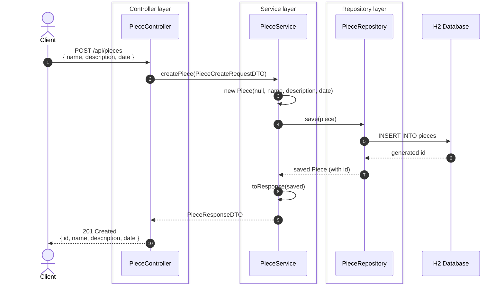

# Sequence Diagram — Create Piece

Flujo de `POST /api/pieces`: registra una nueva pieza física en el archivo.



## Notas

- Toda la operación corre dentro de una transacción (`@Transactional` en `createPiece`).
- El id es `null` al construir la `Piece`; la base de datos lo genera al hacer `save`
  (`GenerationType.IDENTITY`).
- La respuesta es un `PieceResponseDTO`, nunca la entidad `Piece`.

## Ejemplo

Pedido:

```http
POST /api/pieces
Content-Type: application/json

{ "name": "Letter from Cordoba", "description": "Handwritten letter", "date": "1977-05-03" }
```

Respuesta `201 Created`:

```json
{ "id": 1, "name": "Letter from Cordoba", "description": "Handwritten letter", "date": "1977-05-03" }
```
