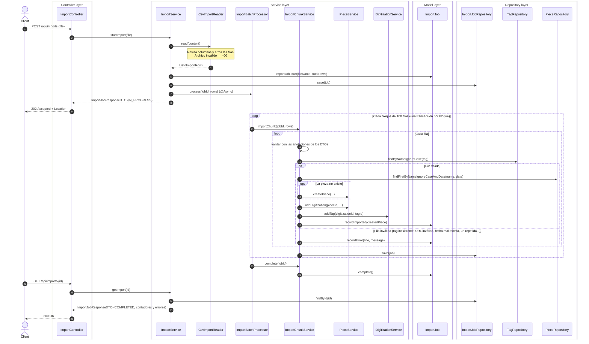

# Sequence Diagram — CSV Import (Batch Process)

Flujo de la carga masiva: `POST /api/imports` revisa el archivo, registra la carga y responde `202` enseguida; el proceso sigue en segundo plano, de a bloques, y el cliente consulta el avance con `GET /api/imports/{id}`.

## Notas

- **En segundo plano:** `ImportBatchProcessor.process` es `@Async`, así que `POST` no espera a que se procesen todas las filas. `startImport` no es transaccional a propósito: la carga se guarda antes de arrancar el proceso, para que el proceso la encuentre.
- **Un bloque, una transacción:** con muchas filas no queda todo en una sola transacción, y el avance (`processedRows`) se ve mientras corre.
- **Mismas reglas que la API:** cada fila se valida con las anotaciones de `PieceCreateRequestDTO` y `DigitizationCreateRequestDTO`, y se carga con los mismos services (`PieceService`, `DigitizationService`). Los tags no son libres: un tag que no está en el catálogo rechaza la fila.
- **Primero validar, después crear:** una fila se valida completa antes de crear nada. Si un service lanzara una excepción a mitad de la fila, marcaría todo el bloque para deshacerse.
- **Errores inesperados** (por ejemplo, la base no responde): la carga queda `FAILED` con el motivo en `failureMessage`; los bloques ya guardados se conservan.
